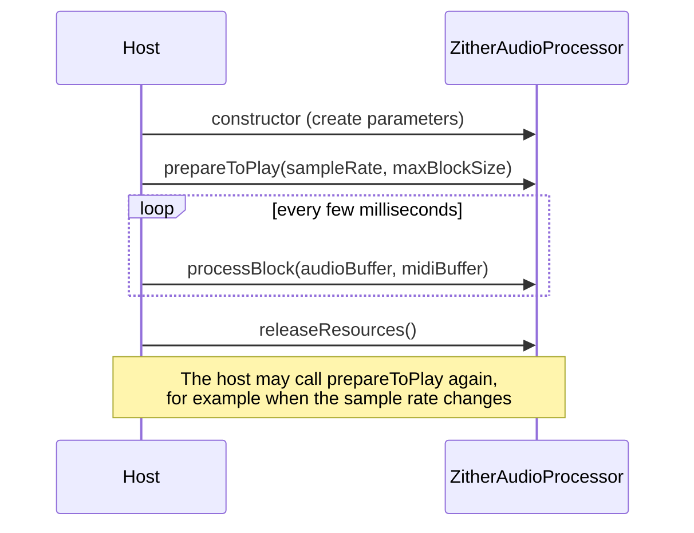

# 1. How a plugin works

## Hosts and plugins

A **plugin** is a library that a **host** (a DAW such as Logic, Ableton Live or Reaper) loads and calls. The host
owns the audio device, the timeline and the mixer. The plugin is asked, over and over, "here's a buffer, fill it
with the next few milliseconds of sound."

**Formats** are the contracts between host and plugin: VST3 (Steinberg), AU (Apple's Audio Unit) and others.
JUCE lets you write the plugin once and builds every format from the same code. In [`CMakeLists.txt`](../../CMakeLists.txt):

```cmake
juce_add_plugin(Zither
    FORMATS          AU VST3 Standalone
    IS_SYNTH         TRUE   # makes sound rather than processing an input
    NEEDS_MIDI_INPUT TRUE   # receives notes
    ...)
```

**Standalone** wraps the same plugin in a small app with its own audio and MIDI settings, which is handy for testing.

## The two halves: processor and editor

| | `AudioProcessor` | `AudioProcessorEditor` |
|---|---|---|
| Job | Makes the sound | Draws the UI |
| Thread | Audio thread (realtime, strict deadline) | Message thread (UI events, painting) |
| Lifetime | As long as the plugin is loaded | Only while the window is open |
| In this repo | [`PluginProcessor.*`](../../Source/PluginProcessor.cpp) | [`PluginEditor.*`](../../Source/PluginEditor.cpp) |

The processor must work with no editor at all, because hosts close plugin windows whenever they like. That's why
everything the sound depends on lives in the processor, and the editor only reads from it or sends requests to it
(see [Realtime safety](09-realtime-safety.md)).

## The lifecycle



### `prepareToPlay (sampleRate, samplesPerBlock)`

Called before audio starts and whenever the sample rate or maximum block size changes. **This is where you allocate
memory and compute anything that depends on the sample rate.** Zither sizes every string's delay line here, prepares
the effects, and resets smoothing:

```cpp
void ZitherAudioProcessor::prepareToPlay (double sampleRate, int samplesPerBlock)
{
    strings.prepare (sampleRate);   // allocates delay lines long enough for a 30 Hz string
    strummer.prepare (sampleRate);
    fx.prepare ({ sampleRate, static_cast<juce::uint32> (samplesPerBlock), 2 });
    ...
}
```

### `processBlock (buffer, midi)`

The heart of the plugin. The host hands you:

- **`buffer`**: one array of floats per channel (here 2, stereo), `buffer.getNumSamples()` long. A synth starts from
  silence (`buffer.clear()`) and writes its output into it.
- **`midi`**: the MIDI events that fall inside this block. Each has a **sample position**, an offset into the block,
  so a note can start exactly where it was played rather than at the start of the block.

A block is often 64 to 1024 samples. At 48 kHz with 256-sample blocks, you have **5.3 ms** to finish each call.
Miss the deadline and the listener hears a click or dropout.

Zither's `processBlock` in order:

1. `ScopedNoDenormals` (see [Realtime safety](09-realtime-safety.md))
2. Clear the buffer, read the parameters (`updateParameters()`)
3. Take any strikes the UI queued (on-screen strumming)
4. Render the strings **in sub-blocks split at each MIDI event and queued strum strike**, so timing is sample-accurate
   (see [Tuning and strumming](07-tuning-and-strumming.md))
5. Publish per-string levels for the UI
6. Run the effects tail, then output gain and the soft clip ([The effects tail](08-the-effects-tail.md))

## Parameters

Parameters are the knobs that a host can see, automate and save. JUCE's
`AudioProcessorValueTreeState` (APVTS) holds them. [`Parameters.h`](../../Source/Parameters.h) declares each one with an
**ID**, a display name, a range and a default:

```cpp
layout.add (std::make_unique<AudioParameterFloat> (id (decay), "Decay", skewed (1.0f, 40.0f, 10.0f), 18.0f, shown (seconds)), ...);
```

- **The ID is a contract.** Hosts save sessions by ID. Renaming `"decay"` would silently reset that knob in every
  saved project. `ParameterID { name, 1 }` carries a version hint for parameters added later.
- **Skewed ranges** (`setSkewForCentre`) give more knob travel to the useful part of a range. Decay runs from 1 to
  40 s, but half the knob's travel covers 1 to 10 s.
- **Reading values on the audio thread:** `getRawParameterValue (id)` returns a `std::atomic<float>*`, which is safe
  to read from any thread. Zither reads all parameters once per block in `updateParameters()`.
- **Saving state:** `getStateInformation` writes the APVTS tree as XML into the host's project, and
  `setStateInformation` restores it.

## MIDI handling

`handleMidi()` in [`PluginProcessor.cpp`](../../Source/PluginProcessor.cpp):

| Message | Zither's response |
|---|---|
| Note on | Snap the key to the nearest string, then strum from it |
| Note off | Nothing by default: **strings ring**. With Release Damping up, the string is damped |
| Sustain pedal | Holds damping back until the pedal lifts |
| All sound off | Silences every string immediately |

## Other things the host asks

- `isBusesLayoutSupported`: Zither accepts stereo output only and no audio input.
- `getTailLengthSeconds() = 30`: tells the host that sound continues after the last note, so it shouldn't cut the
  plugin off while rendering.

## Try it

- Put a breakpoint (or a temporary counter) in `processBlock` and see how often it's called at different buffer
  sizes in the Standalone app's audio settings.
- Find each parameter ID in `Parameters.h`, then find where `updateParameters()` reads it.
