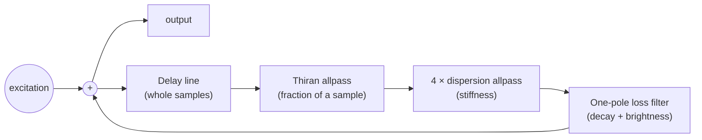

# 5. The waveguide string

This is the core of the instrument: [`Source/dsp/WaveguideString.cpp`](../../Source/dsp/WaveguideString.cpp). It
builds on [Filters](03-filters.md) and [Delay lines](04-delay-lines.md), so read those first.

## The physical picture

Strike a stretched string and two waves run away from the strike point in opposite directions. Each reflects off a
fixed end (the bridge or the nut), flips upside down, and comes back. The disturbance keeps travelling round trips
along the string, and **one round trip takes exactly one period of the note.** Each trip loses a little energy to
the air and the wood, and loses more at high frequencies than at low ones.

A **digital waveguide** simulates exactly that, cheaply:

- a **delay line** for the travel time,
- a few **filters** that lump together everything that happens to the wave during one trip,
- and **feedback** to send it round again.

## Karplus–Strong: the ancestor

In 1983 Kevin Karplus and Alex Strong published a startlingly simple algorithm: fill a delay line of length $P$ with
random noise, then loop it forever through a two-sample average:

```math
y[n] = \tfrac{1}{2}\left(y[n-P] + y[n-P-1]\right)
```

The noise becomes a plucked-string tone at $f_s/P$ Hz. The averaging filter dulls the sound a bit more on every
pass, just as a real string loses its brightness. Jaffe and Smith then extended it with fractional tuning, decay
control and more. Julius Smith later generalised it into the digital waveguide. Zither's string is one of these
**extended Karplus–Strong** strings.

## The loop



The per-sample code (`processSample`) is short:

```cpp
const float x = buffer[(writePos - delayInt) & mask];            // read the delayed wave

float y = thiranCoef * x + thiranX1 - thiranCoef * thiranY1;     // fractional delay
...
for (k = 0; k < 4; ++k) { y = dispersion allpass (y); }          // stiffness
lossState = lossInGain * y + lossPole * lossState;                // loss (one-pole lowpass)

const float out = lossState + excitation;                         // add the hammer
buffer[writePos] = out;                                           // send it round again
```

All the cleverness lives in `updateCoefficients()`, which turns musical requests (pitch, decay seconds,
brightness, inharmonicity) into these few numbers. The rest of this page walks through it.

## 1. Pitch: the loop delay must equal one period

The total delay around the loop, measured at the fundamental, must be exactly $P = f_s / f_0$ samples. Every element
contributes:

```math
P = \underbrace{\text{delayInt}}_{\text{whole samples}} + \underbrace{d}_{\text{Thiran}} + \underbrace{\tau_\text{disp}}_{\text{dispersion}} + \underbrace{\tau_\text{loss}}_{\text{loss filter}}
```

So the code works out the phase delay of the loss and dispersion filters **at $f_0$** first, subtracts them from the
period, then splits what's left into whole samples plus a Thiran fraction (see [Delay lines](04-delay-lines.md)).
This "delay budget" is why the string stays within ±3 cents at any sample rate and any stiffness.

## 2. Decay: gain per round trip from T60

A string with decay time T60 must lose 60 dB (a factor of 1000) in T60 seconds. In that time it makes $f_0 \cdot T_{60}$
round trips, so each trip multiplies the amplitude by

```math
g = 10^{-3 / (f_0 \, T_{60})}
```

```cpp
const double gTarget = std::pow (10.0, -3.0 / (frequency * t60));
```

**Example:** C3 (130.81 Hz) with an 18 s decay makes 2355 trips, so $g ≈ 0.99707$. The string loses only 0.3% per
round trip. That's why loop gains must be computed precisely: a tiny error in $g$ multiplied thousands of times
completely changes the ring.

Real zithers ring longer on the low strings, so the Decay knob is scaled by pitch, relative to C3:

```cpp
baseT60 = decaySeconds * clamp (pow (130.81 / frequency, 0.4), 0.25, 1.5);
```

## 3. Brightness: high frequencies decay faster

If every frequency lost the same amount per trip, the tone would never change as it faded. Real strings get duller
as they ring. The **loss filter** is a one-pole lowpass, which loses a little more at high frequencies on every pass.

Zither specifies it with **two decay targets**:

- at the fundamental: decay in exactly T60, and
- at a high reference frequency ($\max(6\text{ kHz}, 1.5 f_0)$): decay in $T_{60} \times r$, where the Brightness knob
  sweeps $r$ from 0.03 (dark: highs gone almost at once) to 0.8 (bright: highs ring nearly as long as the
  fundamental).

The code solves a small quadratic for the filter pole $p$ that hits both targets. It then corrects the overall gain,
because the filter already attenuates $f_0$ slightly and that would otherwise shorten the decay:

```cpp
const double g = std::min (0.99999, gTarget / std::abs (loss));   // per-trip gain, filter loss removed
```

Specifying it in Hz and seconds (instead of "filter coefficient 0.3") keeps the timbre identical at 44.1 and 96 kHz.

## 4. Inharmonicity: stiff strings stretch their partials

An ideal string's partials (overtones) sit at exact multiples of the fundamental: $f_n = n f_0$. Real steel strings
are **stiff**: they resist bending a little, and more so for short wavelengths. So the higher partials run **sharp**:

```math
f_n \approx n f_0 \sqrt{1 + B n^2}
```

where $B$ is the inharmonicity coefficient. This slight stretching is a big part of why pianos, zithers and
hammered dulcimers sound "metallic" and shimmery rather than electronic.

**How the loop models it:** if high frequencies make the round trip **faster** than low ones, their resonances move
up: they go sharp. A first-order allpass with a **negative** coefficient delays low frequencies more than high
ones. Four of them in series (`kDispersionStages`) give a smooth, increasing stretch:

```cpp
double a = -0.7 * inharmonicity;     // 0 = perfectly harmonic
```

Because the dispersion filters also add delay at $f_0$, they come out of the delay budget too. On very short (high)
strings, the code reduces $a$ until the filters fit inside one period.

## 5. Damping: Release Damping and the sustain pedal

By default a note-off does nothing: **strings ring**. With Release Damping up, releasing a key calls
`setDamped (true)`, which pulls the T60 toward 0.12 s. The pull is interpolated on a logarithmic scale, so the knob
feels even across its range:

```cpp
t60 = exp (log (baseT60) + (log (0.12) - log (baseT60)) * damping);
```

It's the same filter with a smaller gain, like a felt damper touching the string.

## 6. Sleeping: zero CPU for silent strings

Up to 36 strings exist all the time (there's no voice allocation), but most are silent. Each string tracks its peak
over a little more than a period. Once that peak falls below −100 dB, the string resets itself and is skipped by
`StringBank::render` until it is struck again.

## Stability

A feedback loop is stable only if its gain is below 1 at **every** frequency:

- allpasses have gain exactly 1,
- the loss filter has gain ≤ 1 (unity at DC, less above),
- and $g$ is clamped to at most 0.99999.

So every trip loses at least a little energy, and the string can never blow up. The stability test renders a very
stiff 32.7 Hz string for 12 s and checks that every sample is finite.

## Why "modelled, not sampled"

A sampled instrument plays back recordings. Here the timbre emerges from the physics: every strike sends a new
signal into the loop, so velocity, hammer hardness and strike position all change the tone continuously, and no
two strikes are identical. It's also tiny: one string is a few kilobytes of delay line and a dozen numbers.

## Try it

- Set Inharmonicity to 0, then to 100%, and play a low string. Listen to the upper partials.
- Brightness 0% vs. 100% with a long decay: listen for how fast the tone darkens.
- In the code, change `kDispersionStages` to 1 or 8 and run the pitch tests. Do they still pass, and why?

## Further reading

- Julius O. Smith III, [*Physical Audio Signal Processing*](https://ccrma.stanford.edu/~jos/pasp/): see the chapters on
  digital waveguides, Karplus–Strong, Thiran allpass interpolation and dispersion.
- K. Karplus and A. Strong, "Digital Synthesis of Plucked-String and Drum Timbres", *Computer Music Journal*, 1983.
- D. Jaffe and J. O. Smith, "Extensions of the Karplus-Strong Plucked-String Algorithm", *Computer Music Journal*, 1983.
