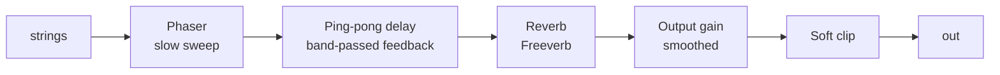

# 8. The effects tail

The strings go through a chain of effects designed with them: the "electric zither" sound of
*Flow Goes The Universe*. Code: [`Source/fx/FxChain.cpp`](../../Source/fx/FxChain.cpp), plus the output stage in
[`PluginProcessor.cpp`](../../Source/PluginProcessor.cpp).



Unlike the string core, these use JUCE's `juce::dsp` building blocks.

## Phaser

A **phaser** passes the signal through a chain of allpass filters (see [Filters](03-filters.md)) and mixes the result
with the original. The allpasses shift the phase of each frequency by a different amount, so where the shifted copy
ends up opposite the dry signal, they cancel and leave **notches** in the spectrum. A slow LFO (low-frequency
oscillator) sweeps the allpasses' frequency, and the notches drift up and down.

JUCE's `dsp::Phaser` has 6 first-order allpass stages. Zither runs it **very** slowly (0.12 Hz by default: one sweep
every ~8 s) at a low mix, so it reads as a gentle swirl rather than a jet-plane whoosh.

## Ping-pong delay with filtered feedback

A stereo echo that bounces between left and right:

```cpp
const float echoL = delay.popSample (0, d);
const float echoR = delay.popSample (1, d);

delay.pushSample (0, input + fb * feedbackTone (echoR, 0));   // new sound enters left, plus the right's echo
delay.pushSample (1, fb * feedbackTone (echoL, 1));           // right only ever hears the left's echo
```

Each repeat crosses sides because each channel's delay is fed by the **other** channel's output.

**Echoes that darken and thin.** The feedback goes through a band-pass filter (a 4.5 kHz lowpass, then a 140 Hz
highpass; see `feedbackTone`). Each repeat passes through it once more, so the 5th echo has been filtered 5 times:
duller and lighter in the bass. Long feedback settings melt into a soft wash instead of building into a muddy,
boomy pile-up. This is core value #5 in the project guide.

At the default feedback of 0.55, the 5th echo is $0.55^5 ≈ 0.05$ of the original (−26 dB), even before filtering.

## Reverb: Freeverb

`juce::dsp::Reverb` is **Freeverb**, a classic public-domain design by Jezar at Dreampoint:

- **8 parallel feedback comb filters** per channel, each with a lowpass in its loop. They make a dense set of decaying
  echoes. The lowpass is the **damping**, which makes the high frequencies in the tail die first, as in a real room.
- **4 series allpass filters**, which smear those echoes into a smooth diffuse wash without colouring the tone.

**Room Size** maps to the combs' feedback (longer tail) and **Reverb Mix** to wet versus dry. One gotcha in the code
comment: JUCE's reverb internally multiplies wet by 3 and dry by 2, so the code scales the parameters down to match.

## Parameter smoothing

If a gain jumps from 0.5 to 0.8 between two samples, you hear a click. Turning a knob makes many small jumps, which
sound like a buzzy **zipper noise**. `juce::SmoothedValue` glides to each new target over a set time:

```cpp
outputGain.reset (sampleRate, 0.05);      // 50 ms glide
...
const float gain = outputGain.getNextValue();   // per sample
```

The delay's time, feedback and mix, and the output gain, are all smoothed.

## Soft clipping: a safety net

Floating-point audio can exceed ±1.0, but the DAC can't, so it would **hard clip** (flatten the peaks), which sounds
harsh. Zither ends with a gentle **soft clip**: perfectly linear up to 0.85, then a `tanh` curve that bends smoothly
toward 1.0 and never reaches it:

```cpp
if (|x| <= 0.85) return x;
return sign(x) * (0.85 + 0.15 * tanh ((|x| - 0.85) / 0.15));
```

At normal levels it does nothing at all. It only catches the occasional loud stack of strings and echoes. Per the
project's values, "the output soft-clip is a safety net, not a sound."

## Try it

- Set Delay Feedback to 95% and Delay Mix to 100%, then play one note. Listen to each echo get darker and thinner.
- Turn the Delay Time knob while echoes are playing and listen for the tape-like pitch bend from smoothing.
- Set Phaser Mix to 100% and Phaser Rate to 2 Hz to hear the effect clearly, then return them to their defaults.
