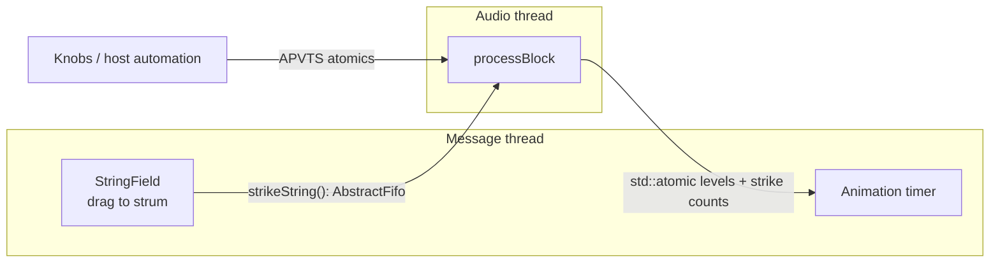

# 9. Realtime safety

## The deadline

The audio thread must deliver every block before the sound card needs it. At 48 kHz with 128-sample blocks, that's
**2.7 ms**, every time, forever. Being fast *on average* isn't enough. **One slow call is an audible click.**

So code on the audio thread (`processBlock` and everything it calls) must never do anything whose duration is
unbounded or outside your control.

## The rules

| Don't, on the audio thread | Why | What Zither does instead |
|---|---|---|
| Allocate or free memory (`new`, `std::vector::push_back`, `std::string`, …) | The allocator may take a lock or ask the OS for memory | Size every buffer in `prepareToPlay` (`buffer.assign` in `WaveguideString::prepare`), and use `std::array` for queues (`Strummer`) |
| Lock a mutex | The thread holding it (e.g. the UI) can be paused by the OS | Lock-free FIFO and atomics (below) |
| File, network or console I/O, including logging | Can block for milliseconds | No logging in `processBlock` |
| Unbounded loops | No upper bound on time | Strings sleep, and loops run over fixed sizes |

These are rules in [`CLAUDE.md`](../../CLAUDE.md): "No allocation, locks, logging or I/O in `processBlock`."

## Denormals

As a string decays, its samples get tiny: 1e-30, 1e-38, … Below about 1.2e-38, floats switch into a **denormal**
(subnormal) format that many CPUs process **10–100× slower**. A plugin whose feedback loops are all quietly decaying
can suddenly spike in CPU while making no sound at all.

Two defences:

```cpp
juce::ScopedNoDenormals noDenormals;   // first line of processBlock: CPU flushes denormals to zero
```

and the string's own **sleep** at −100 dB (see [The waveguide string](05-the-waveguide-string.md)), which stops
processing silent strings long before their samples get that small.

## Talking between threads

The UI (message thread) and the audio thread run at the same time. They need to share information without locks.



### UI → audio: a lock-free FIFO

When you drag across the on-screen strings, the UI must trigger strikes. It can't call into the string bank directly,
because the audio thread might be in the middle of using it. Instead `strikeString()` writes into a
`juce::AbstractFifo`, a **single-producer, single-consumer ring buffer**:

```cpp
// UI thread
const auto scope = uiStrikeFifo.write (1);
uiStrikes[scope.startIndex1] = { stringIndex, velocity };

// Audio thread, start of processBlock
const auto scope = uiStrikeFifo.read (uiStrikeFifo.getNumReady());
scope.forEach ([this] (int index) { strings.excite (...); });
```

It works without locks because only one thread ever writes the write index and only one thread ever writes the read
index. If the FIFO is ever full, the strike is simply dropped. Dropping is better than blocking.

### Audio → UI: atomics

The visuals need each string's level and to know when it was struck. The audio thread stores these in
`std::atomic<float>` and `std::atomic<uint32_t>` arrays, and the UI reads them at 30 Hz. `memory_order_relaxed` is
enough because each value is independent, so nothing needs ordering against anything else. The UI uses
`exchange (0)` to "take" a level, so peaks between frames aren't lost.

### Parameters

APVTS stores each parameter value in a `std::atomic<float>`, so the audio thread can read knobs that the UI or host
is changing, safely and without locks.

## Rule of thumb

> If it might wait, it doesn't belong on the audio thread.

Paint code is different. The UI thread can allocate (e.g. the `juce::Path`s in `WaterScene`), and it only has to
keep up with 30 frames per second, not with audio.

## Further reading

- Ross Bencina, [*Real-time audio programming 101: time waits for nothing*](http://www.rossbencina.com/code/real-time-audio-programming-101-time-waits-for-nothing)
- Timur Doumler's CppCon talks on lock-free programming for audio.
