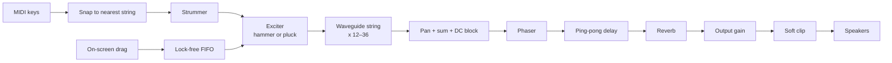

# Zither DSP wiki

A learning notebook for the ideas behind this instrument: how an audio plugin works, the digital signal
processing (DSP) that makes a string ring, and why each piece of the code is written the way it is.

Each page explains one concept from the ground up, then points at the exact code in this repo that uses it.
Read them in order the first time; later, use them as a reference.

## Learning path

| # | Page | You'll learn |
|---|---|---|
| 1 | [How a plugin works](01-how-a-plugin-works.md) | Hosts, JUCE's `AudioProcessor`, `prepareToPlay` / `processBlock`, parameters, MIDI |
| 2 | [Digital audio basics](02-digital-audio-basics.md) | Samples, sample rate, Nyquist, frequency vs. period, MIDI → Hz, cents, decibels |
| 3 | [Filters](03-filters.md) | Difference equations, one-pole lowpass/highpass, DC blockers, allpass filters, phase delay, combs |
| 4 | [Delay lines](04-delay-lines.md) | Circular buffers, fractional delay, linear vs. allpass interpolation |
| 5 | [The waveguide string](05-the-waveguide-string.md) | Karplus–Strong, tuning the loop, T60 decay, brightness, inharmonicity, damping |
| 6 | [Exciters](06-exciters.md) | Felt hammers vs. plucks, contact time and brightness, strike position |
| 7 | [Tuning and strumming](07-tuning-and-strumming.md) | Modes, "no wrong notes" key snapping, sample-accurate scheduling |
| 8 | [The effects tail](08-the-effects-tail.md) | Phaser, ping-pong delay with filtered feedback, Freeverb, smoothing, soft clipping |
| 9 | [Realtime safety](09-realtime-safety.md) | The audio thread's rules, denormals, lock-free UI ↔ audio communication |
| 10 | [Testing DSP](10-testing-dsp.md) | Measuring pitch and decay in unit tests |

Also: [Glossary](glossary.md) · [Learning log](learning-log.md) (your own notes and questions)

## The whole instrument on one page

| Concept | Where it lives |
|---|---|
| Plugin lifecycle, MIDI, parameters | [`Source/PluginProcessor.cpp`](../../Source/PluginProcessor.cpp), [`Source/Parameters.h`](../../Source/Parameters.h) |
| Waveguide string | [`Source/dsp/WaveguideString.cpp`](../../Source/dsp/WaveguideString.cpp) |
| Hammer and pluck | [`Source/dsp/Exciter.cpp`](../../Source/dsp/Exciter.cpp) |
| String bank, panning, DC blocker | [`Source/dsp/StringBank.cpp`](../../Source/dsp/StringBank.cpp) |
| Modes and key snapping | [`Source/tuning/Tuning.cpp`](../../Source/tuning/Tuning.cpp) |
| Strum scheduling | [`Source/tuning/Strummer.h`](../../Source/tuning/Strummer.h) |
| Phaser, delay, reverb | [`Source/fx/FxChain.cpp`](../../Source/fx/FxChain.cpp) |
| Tests | [`tests/`](../../tests) |

## Keeping it current

These pages describe the code as it is. When the DSP changes, update the matching page in the same branch.
Formulas use GitHub's math syntax (`$...$`) and diagrams use Mermaid; both render on github.com.

## Further reading

- Julius O. Smith III, [*Physical Audio Signal Processing*](https://ccrma.stanford.edu/~jos/pasp/): the reference
  for waveguide strings. Free online.
- Julius O. Smith III, [*Introduction to Digital Filters*](https://ccrma.stanford.edu/~jos/filters/): filters,
  allpasses, phase delay. Free online.
- [JUCE tutorials](https://juce.com/learn/tutorials/): the official step-by-step plugin tutorials.
- Ross Bencina, [*Real-time audio programming 101*](http://www.rossbencina.com/code/real-time-audio-programming-101-time-waits-for-nothing):
  why the audio thread has strict rules.
- Will Pirkle, *Designing Audio Effect Plugins in C++*: a practical textbook covering filters, delays and reverbs.
